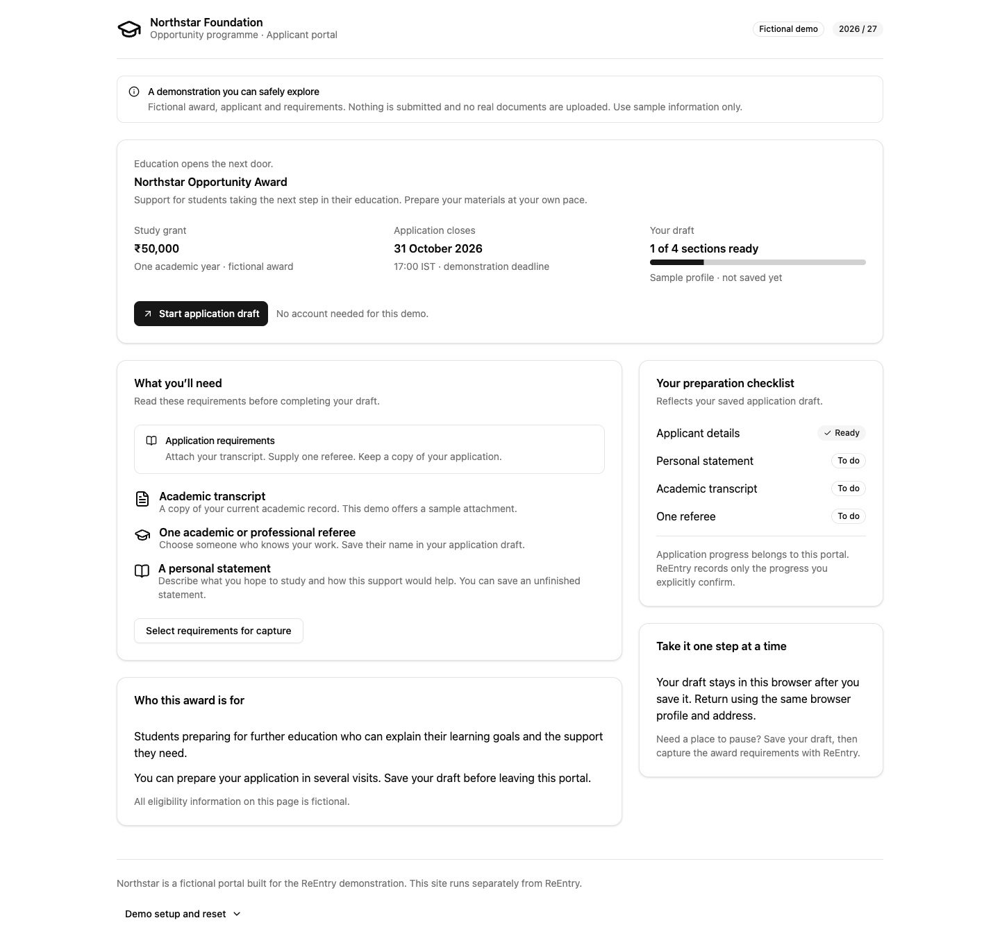

# Presenting the Northstar sandbox

For the separate reused shopping sandbox, run `pnpm sandbox:commerce` and follow [the commerce walkthrough](AGENT_FOUNDATION.md#reused-shopping-sandbox). Its default port is 4177. It uses upstream Sauce Labs UI and simulated orders; Northstar remains the controlled application/changed-instruction scenario.

Northstar is a fictional scholarship portal that runs on a separate local address from ReEntry. It is demonstration equipment, not an actual scholarship provider. All applicant details, award amounts, dates and requirements are fictional. Use sample data only.



[View the saved application draft screen](evidence/northstar-application.png).

## Open the portal

Start ReEntry with `./start.sh`. In a separate terminal:

```sh
pnpm sandbox:sites
```

Open the **Northstar demo portal** address printed in that terminal. The default is http://127.0.0.1:4176/instructions.html. If 4176 is occupied, the command selects a nearby free port and prints that address. To require a particular port, use `pnpm sandbox:sites start 4176`; an occupied explicit port produces a clear error without stopping the other service. Port 4173 is used by another service on the author's computer.

Keep this terminal running. Ctrl+C stops only the portal; `./stop.sh` stops ReEntry separately. Starting the portal builds its static assets and resets requirements to V1; the saved browser draft is kept. Continue to use the same portal address and Chrome profile because both source comparison and browser draft storage depend on them.

## Automatic companion demonstration

Phase 3 adds a fictional final review, validation failures and browser-local submission receipt. Follow [the automatic progress journey](AGENT_PROGRESS.md#try-the-application-journey) to use it without selection or a checkpoint form. Nothing is submitted externally; reset removes the local receipt as well as the draft. The manual demonstration below remains available.

## A complete manual demonstration

1. Choose **Start application draft**. A fictional applicant profile is provided. Enter a short personal statement and choose **Attach sample transcript**. This changes a local demo flag; it does not read or upload a real PDF.
2. Choose **Save application draft**. Wait for the saved message. The preparation checklist reflects the current fields; changes remain unsaved until this action succeeds.
3. Choose **View award requirements**, then **Select requirements for capture**, or select the requirement paragraph yourself. Invoke the real ReEntry extension and confirm the capture.
4. In ReEntry, save a goal such as “Finish the Northstar application,” progress such as “Sample transcript attached; personal statement drafted,” and the portal's **application.html** address as the work link. The exact work link appears under the portal's **Demo setup and reset** disclosure. ReEntry does not inspect the application fields.
5. Close the application tab to represent an interruption. In another terminal run:

   ```sh
   pnpm sandbox:switch v2
   ```

6. Return to the ReEntry checkpoint and check instructions again. The same portal source address now requires **two referees** and shows an update notice. Select and recapture the same requirement paragraph, then confirm that it is the same section.
7. Inspect old/current evidence. Generate a recovery suggestion using your configured model, review/correct it, and save the reviewed action. Synthetic browser-test model results do not establish real inference; a normal NVIDIA-configured app uses NVIDIA after processing agreement.
8. Choose **Continue to saved work**. The portal reopens its previously saved statement and sample transcript; the additional referee field is present. Complete the next small step and save the application draft again.

The portal's **Review application** dialog shows ready/missing sections. It never submits anything. **Demo setup and reset → Reset demo application draft** requires confirmation and clears only this portal's draft, leaving ReEntry checkpoints and the source scenario intact.

## Repeat and compare

```sh
pnpm sandbox:switch v1        # One referee
pnpm sandbox:switch v2        # Two referees
pnpm sandbox:switch cosmetic  # Punctuation-only change
```

Reload the source after switching. The URL and saved draft stay the same. Cosmetic changes are still text edits; the model/user must assess their significance. Scenario switching changes only the served JSON; the browser validates it and never silently substitutes old requirements if loading fails.

The minimal HTML fixtures, deadline/decrease/removed/contradictory variants, and simulated model failures remain useful deterministic test equipment. They are separate from this richer manual presentation surface. `pnpm sandbox:build` builds the portal without starting a server; Vite reuses the installed registry UI/theme, and http-server supplies static hosting. There is no new portal backend or second product to operate.
